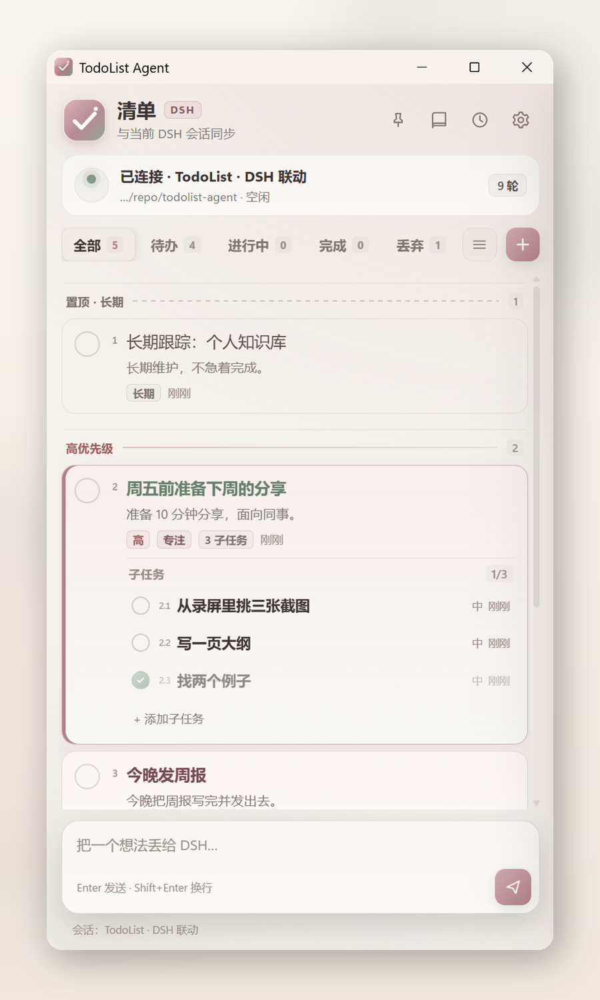
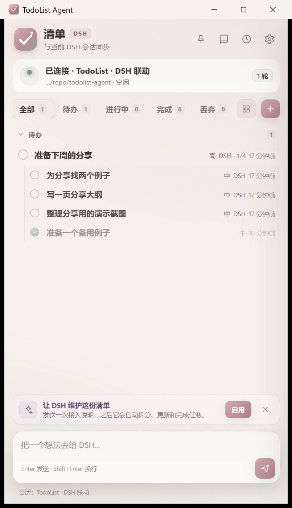
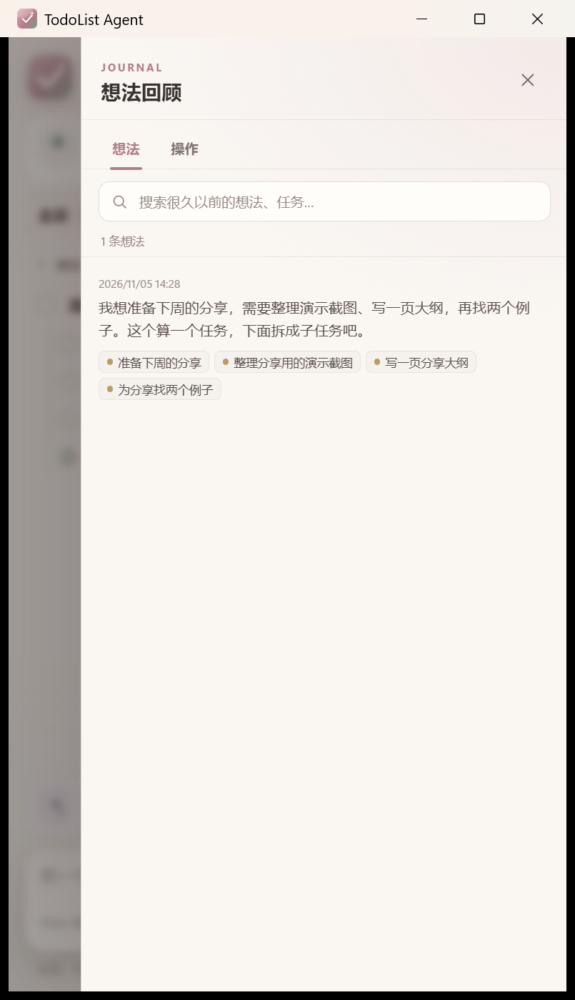
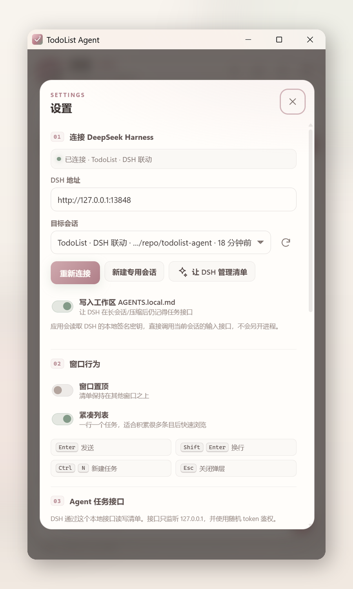
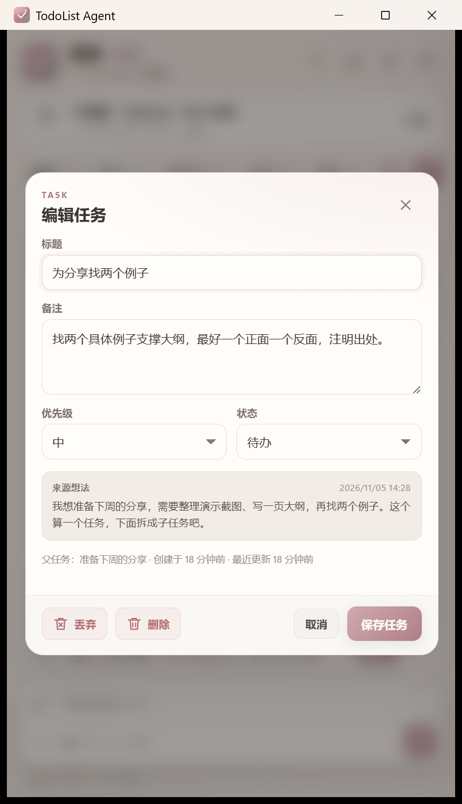

# TodoList Agent

**A local-first Windows todo list that turns messy thoughts into an executable list with DeepSeek Harness.**

[English](README.md) · [简体中文](README.zh-CN.md) · [Watch the demo](https://www.bilibili.com/video/BV1PR486wEGL/)

TodoList Agent is a small desktop application built with **Go + WebView2**. It connects to a dedicated **DeepSeek Harness (DSH)** session, so the things you type at the bottom of the window can be understood, split into tasks, and kept in sync with the agent.

The important part is not that it is another todo app. It is a place where you can think out loud: fragments, complaints, links, half-finished plans, and the occasional “I should really do this”. DSH only turns **explicit action intentions** into tasks. The original words stay in a searchable journal, together with the tasks they produced.

<p align="center">
  
</p>

## Demo

<p align="center">
  <a href="https://www.bilibili.com/video/BV1PR486wEGL/">
    
  </a>
</p>

A 60-second walkthrough on Bilibili: starting from an empty list, three rounds of conversation with DSH, task extraction, subtasks, focus, checkbox completion, and the journal / activity panels.

## Why this exists

Most todo apps assume you already know what the task is. Real life usually starts earlier than that: you have a vague thought, a deadline buried in a sentence, or five things mixed into one paragraph.

TodoList Agent moves that first step into the desktop:

- you write the thought where it appears;
- DSH reads it in a real conversation and extracts the action;
- the result comes back as a clean task, with the original quote still attached;
- you can refine, focus, split, delete, or finish it without leaving the window.

The Windows app sends messages to the running DSH through the local TodoList connector. Paired Android devices relay messages through the Windows app.

## Features

### A real DSH conversation, not a one-way form

- The app connects to the TodoList connector in the local DSH instance.
- The DSH connector creates and initializes a processing session, then reuses it.
- Messages you send appear in DSH as normal user messages, so the agent sees the full context and can reply.
- DSH can add, update, start, complete, reopen, and delete tasks through the local bridge API.

### Messy input, explicit tasks

- A message may contain several actions; DSH can create several tasks from one thought.
- Pure emotion, commentary, and link sharing do not have to become tasks.
- When a message contains a deadline (“tonight”, “before Friday”, “this weekend”), the time is written into the **task title**, not buried in notes.
- Reopening or editing a task preserves the original wording and its source.

### One level of subtasks

A task can have subtasks when the work genuinely has steps, for example “prepare a talk” → outline / examples / screenshots.

- Parent tasks show progress such as `2/3`.
- Subtasks have their own status and can be completed or deleted independently.
- Subtasks cannot be nested further; the tree stays at one level.
- Deleting a parent task deletes its subtasks after a confirmation.

### Focus, priority bands, and ordering

- The list can focus one task or subtask at a time.
- The focused item has a rose border and a bold sage-green title.
- Tasks are ordered into **Pinned · Long-term**, **High**, **Normal**, and **Low** bands.
- Dragging a task into another band changes its priority; dragging inside a band changes its order.
- Tasks DSH extracts from everyday input go at the end of their priority band. DSH can use `placement: "first"` when the user asks to put a task first.
- Each task has a small display number (`2.4`) next to the checkbox. DSH can use that number to refer to a task precisely.

### Journal and activity history

Every message sent from the desktop composer is stored as a **journal entry**, even if it never becomes a task.

- Search old thoughts or task titles.
- See which tasks were created from a thought.
- Jump from a task back to its source message.
- Switch to **Activity** to see additions, completions, deletions, moves, and their original quotes.

### Built for a long list

- Card view for context and subtasks.
- Compact view for scanning dozens or hundreds of tasks by status and priority.
- The completed group collapses by default.
- Tray support and a light warm-paper theme designed to stay on screen for a long time.

<p>
  
  
</p>
<p>
  
  
</p>

## Requirements

- **Windows 10/11 (64-bit)**
- **Microsoft Edge WebView2 Runtime** (normally included with Windows 11)
- **DeepSeek Harness** installed and running locally

The connector is tested on **DSH 0.2.2-rc.1**. Other versions attempt to load and show the host version and session service status in the plugin page. The Android app supports Android 8.0 or later on arm64 and x86-64.

## Install

### From a release

Download and run `TodoListAgent-Setup-win64.exe` from [GitHub Releases](https://github.com/Dusk-Hermit/todolist-agent/releases). Setup installs for the current user, creates a Start menu shortcut, and downloads WebView2 if needed. The ZIP release also includes `install.cmd`.

### Install the DSH connector

On each Windows computer that handles prompts, download `todolist-agent-dsh-connector-<version>.tgz` from the same release and install it into the DSH profile you use. For DSH Desktop, run this in PowerShell.

```powershell
dsh plugin --profile desktop add "C:\path\to\todolist-agent-dsh-connector-0.4.17.tgz"
```

Use `web` for the DSH Web profile or specify your custom profile name. If `dsh` is outside PATH, use PowerShell's `&` to run `resources\runtime\cli\bin\dsh.cmd` inside the DSH installation folder. Restart the selected DSH profile and reopen TodoList Agent or click **重新连接** in its settings. Android receives execution results from the paired computer.

### Portable

`TodoListAgent.exe` is a single executable. Put it anywhere and run it. No installer is required.

## First run

1. Start **DeepSeek Harness**.
2. Launch **TodoList Agent**.
3. The app registers its local task bridge with the connector, which creates a processing session and sends its initialization prompt.
4. Once initialization completes, the connector accepts queued thoughts. Use the DSH plugin page to inspect initialization and create or switch processing sessions.

From then on:

- Type a thought in the composer and press `Enter`.
- DSH reads the message and updates the list through the local API.
- Use the task actions to edit, split, delete, finish, or focus.

## Android and LAN sync

1. Install version 0.3.0 or later on Windows and install `TodoListAgent-android.apk` on each Android device. [GitHub Releases](https://github.com/Dusk-Hermit/todolist-agent/releases)
2. Connect the devices to the same LAN. In **Settings → LAN sync**, generate a pairing code on Windows and paste it into each Android app.
3. Paired devices discover each other and sync while the apps are running. The refresh button scans on demand and reports the result. If multicast is unavailable, enter the PC's LAN IPv4 address on Android. If Windows Firewall asks, allow the app on private networks. Discovery and sync use UDP and TCP port 17891.
4. Set up a DSH session on each Windows computer. Android can remember a preferred computer. If it or its DSH becomes unavailable, Android syncs with another ready computer before sending fresh prompts there. When the preferred computer returns, it receives the synchronized tasks, messages, and reply history.

Paired devices use encrypted connections and exchange changed records. Edits to separate tasks merge. Concurrent changes to the same task use that task's latest edit or deletion. Deletion markers keep stale devices from restoring deleted tasks. Upgrade all paired devices to 0.4.8 or later to use this merge behavior. Discovery follows the IPv4 multicast announcement and reply pattern used by [LocalSend](https://github.com/localsend/localsend).

An idle PC collects new messages from already-synced online devices for about 350 milliseconds. Offline and newly reconnected devices keep the five-second backlog window. The PC sorts received messages by their creation times and sends them to DSH one at a time. New inputs join the pending queue during processing. The PC asks paired devices to sync as soon as the batch settles, with periodic sync as a fallback.

To send text from another Android app, choose **TodoList Agent** in the system share sheet or in the text selection menu, then confirm **加入待发队列**. Shared text uses the same queue as messages typed into TodoList Agent.

When an acknowledgement or execution result is missing, the desktop app checks the original session by request ID or the legacy message marker. Use **重新核对** to check again or **刷新同步** on Android to pull the latest status. The activity history shows the turn and counts of successful, failed, and unconfirmed tool calls. Messages with an ambiguous result stay under review to avoid repeating actions. Use the DSH profile that holds the original session history.

For multi-PC routing, upgrade Android and every DSH computer to 0.4.0 or later. A prompt awaiting acknowledgement stays assigned to its original computer so that a connection failure cannot replay it on another computer. Each DSH session keeps its own context. Use comma-separated IPv4 addresses when multicast discovery is unavailable.

### Using LAN sync safely

- **Use a trusted home or office network.** Avoid LAN sync on public or guest Wi-Fi. To turn it off, choose **Settings → LAN sync → Disable**. On Windows, keep the firewall enabled and allow the app only on trusted private networks. Keep UDP and TCP port 17891 off internet-facing router port forwards. [Windows Firewall profiles](https://learn.microsoft.com/en-us/windows/security/operating-system-security/network-security/windows-firewall/#firewall-profiles)
- **Keep the pairing code private.** Anyone with the code and network access to your devices can impersonate a paired device, read or change synced data, and submit prompts to a paired Windows computer's DSH. If the code leaks or a paired device is lost, generate a new code and re-pair the devices you still trust.
- **Captured discovery announcements can be replayed.** A replay can make the app try to connect to the wrong address and interfere with discovery. Sync and prompt delivery use a separate encrypted connection authenticated with the pairing code. Replaying an announcement alone cannot read tasks or inject prompts.

## Updates

Both apps check GitHub Releases at startup. **Settings → About** also offers a manual check and one-click update. The updater verifies the downloaded package. Windows restarts the app after setup. Android offers optional automatic downloading and installation, subject to the system's permission and confirmation prompts. Install 0.4.0 manually when upgrading from earlier versions.

Starting with 0.4.9, the updater checks the latest stable Release's download link first, and falls back to the GitHub REST API if it cannot read the release manifest. If update checks fail, open **GitHub Releases** from **Settings → About** and download `TodoListAgent-android.apk` or `TodoListAgent-Setup-win64.exe` from the release's assets. [Latest stable release](https://github.com/Dusk-Hermit/todolist-agent/releases/latest)

When publishing a stable release, run `.\release-manifest.ps1 -Tag <tag> -Directory <release-folder>` after building and signing the packages. Upload the generated `TodoListAgent-update.json` alongside the packages.

Download installers from this project's GitHub Releases. The Windows updater checks the package against GitHub's SHA-256 digest over HTTPS. It relies on the security of the repository's release permissions and currently has no independent publisher signature check.

## Daily use

| Action | Result |
|---|---|
| `Enter` | Send the thought to DSH |
| `Shift+Enter` | New line |
| `Ctrl+N` | Create a local task |
| `Ctrl+,` | Open settings |
| Click the checkbox | Complete / reopen a task |
| Click a task title | Open the task editor |
| Click the target icon | Focus / unfocus a task |
| Drag the grip next to a task number | Reorder tasks or subtasks, or move a top-level task to another priority band. Hold near a list edge to scroll. |
| Book icon | Open the thought journal |
| Clock icon | Open activity history |
| List / grid icon | Switch card and compact views |

## How it works

### DSH connection and execution receipts

The plugin listens on `127.0.0.1:17892` by default. To change the port, set `config.port` on the `todolist-agent-connector` row in the active DSH profile's `cordis.patch.yml`. The plugin writes the active port and a fresh key to `%USERPROFILE%\.dsh\todolist-connector.json` on startup. The Windows app reads that single endpoint and encrypts and authenticates requests and receipts. Keep the file within your own Windows account.

The versioned `/todolist/v1/rpc` endpoint registers the task bridge, assigns processing sessions, submits thoughts, and reads receipts. `todolist/status` reports the time the message entered the session, turn number, end reason, and tool outcomes. `todolist/wait` listens for turn completion. The Windows app also keeps periodic receipt checks for recovery.

Choose a model provider, model, and reasoning effort under **Plugins → todolist-agent-dsh-connector** in DSH. The next TodoList prompt applies those settings to the linked session. **Use session settings** follows the session's current model. TodoList for Windows connects only to the plugin endpoint, and Android connects to the paired PC's LAN service.

The same page shows the listening address, versions, event wait limit, and recent runtime diagnostics. **Check for updates** reads the direct GitHub Release manifest first. **Update online** verifies the package size and SHA-256, then installs a newer stable release into the active DSH profile. Restart DSH to activate it.

### The dedicated session

The connector owns processing sessions and saves their state in `todolist-backends.json` under the active DSH profile. It fingerprints its bundled `prompt.md` and initializes a new session when those instructions change. A changed bridge address, credential, or working directory also creates a new session.

The DSH plugin page can create a new backend or select a previous backend with matching instructions and bridge settings. Initialization failures keep thoughts queued in Windows. Each prepared message keeps its original session across switches and restarts. Upgrade Windows and the connector together to 0.4.17.

### Sending a thought

Windows obtains a persistent message assignment through `todolist/prepare`, then submits the thought through `todolist/prompt`. A hidden marker is appended to the message:

```html
<!-- todo-msg:<id> -->
```

DSH passes it back as `sourceMessageId`, which is how the app links a task, its activity events, and the original journal entry. If DSH omits the marker, the app can still attach newly created tasks to the most recent user message within a six-hour window.

### The reverse bridge

The app listens on `127.0.0.1:17890` (configurable) with a random bearer token. The URL and token are written to `%APPDATA%\TodoListAgent\bridge.json`.

DSH can then call:

```http
GET  /api/todos
GET  /api/journal?limit=20&q=keyword

POST /api/todos
```

Example actions:

```json
{"action":"add","title":"周五前准备下周的分享","priority":"high","sourceMessageId":"..."}
{"action":"update","id":"...","title":"...","status":"doing"}
{"action":"complete","id":"..."}
{"action":"delete","id":"..."}
```

`GET /api/todos` includes a display-only `number` field (`2.4`) that DSH can use when the user refers to a task by number.

## Task model

### Status

`todo` → `doing` → `done`

Deleting a task removes it from the list and records the change in Activity. Upgrading from an older version moves previously dropped tasks out of the list and keeps their snapshots in Activity. Their remaining subtasks become top-level tasks.

### Notes format

Task notes have a stable shape:

```text
{{current detailed description}}

-------

- {{newest original quote}}
- {{older original quote}}
```

The description is rewritten as the task evolves. Original quotes are only appended, newest first. This keeps the actionable summary at the top while preserving the user's own wording below.

### Display numbers

Numbers are computed from the current order and are never persisted:

- top-level tasks: `1`, `2`, `3`, …;
- subtasks: `2.4`, meaning the fourth subtask of the second top-level task.

Numbers change when tasks move, so DSH should re-read `GET /api/todos` before acting on a number.

## Data and privacy

| Path | Contents |
|---|---|
| `%APPDATA%\TodoListAgent\data.json` | Tasks, journal entries, activity events, preferences, bridge token |
| `%APPDATA%\TodoListAgent\bridge.json` | Local bridge URL and bearer token |
| `%APPDATA%\TodoListAgent\icon.ico` | Runtime window icon |

- Tasks, journal entries, and activity history are stored locally and copied to paired devices when LAN sync is enabled.
- The bridge binds to loopback only.
- The connector generates its own key for communication with the local Windows app.
- The app does not capture the screen, control the keyboard, or automate the DSH UI.

## Build from source

Requirements:

- Go 1.26.10+
- `rsrc` for embedding the Windows icon
- Windows SDK/WebView2 development environment

```powershell
git clone https://github.com/Dusk-Hermit/todolist-agent.git
cd todolist-agent
.\build.ps1
```

The build script embeds the web UI, icon, and manifest, then writes `dist\TodoListAgent.exe` and `dist\TodoListAgent-win64.zip`.

```powershell
# Also build the Windows installer. Requires Inno Setup 6.
.\build.ps1 -Installer
```

For Android development, open `android/` in Android Studio with JDK 17, Gradle 8.6, Android SDK 34, and NDK 27.0.12077973. On Windows, `gradle -p android :app:assembleDebug` writes the APK to `android/app/build/outputs/apk/debug/`.

## Project layout

```text
app.go        application state, task operations, snapshots
store.go      persistence and migration
dsh.go        connector connection, prompt delivery and receipts
bridge.go     local loopback API used by DSH
window_windows.go   WebView2 bindings and window lifecycle
win32_windows.go    Windows integration for title bar, icon, and tray
android/      Android Studio project
lan*.go       device discovery, authenticated transport, and sync
replica.go    incremental merge and conflict resolution
web/          embedded HTML/CSS/JS interface
install.ps1   per-user installer
build.ps1     release build
docs/         screenshots
```

## Design choices

- **Local first.** No account, no cloud sync, no background service beyond the loopback bridge.
- **One level of nesting.** Enough structure for real work, without turning the list into an infinite tree.
- **The original words stay.** Summaries are useful, but the source is often the most valuable context months later.
- **A dedicated session.** The agent gets a stable place to work without taking over the conversation you are using.

## Limitations

- Windows only.
- Requires a running local DSH instance.
- One level of subtasks by design.
- The bridge is loopback-only; it is not designed for remote access.
- DSH is a fast-moving project, so internal API changes may require an app update.

## Credits

- Built with [Go](https://go.dev/), [go-webview2](https://github.com/jchv/go-webview2), and [systray](https://github.com/getlantern/systray).
- DSH integration uses the DeepSeek Harness plugin and session services.
- The app's visual direction is inspired by warm paper, dusty rose, and sage green.

---

If TodoList Agent is useful to you, a star helps. Bug reports and focused pull requests are welcome.
