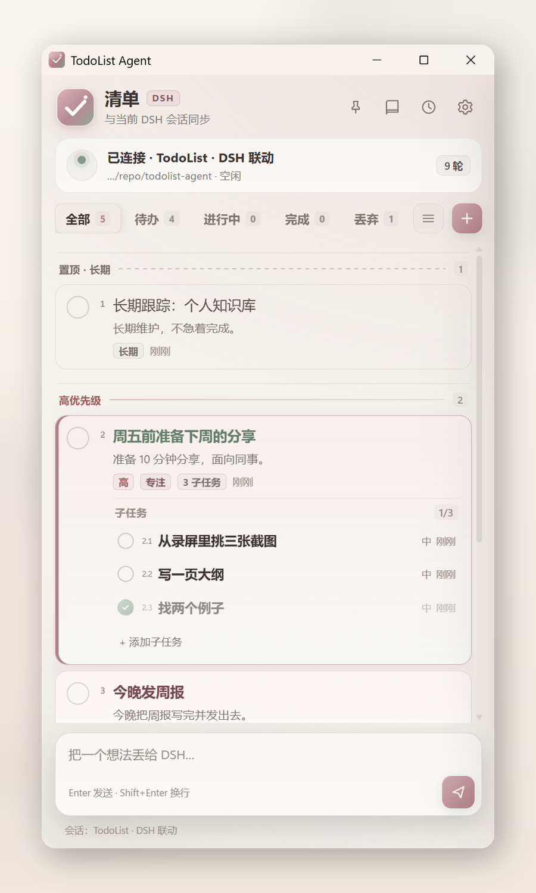
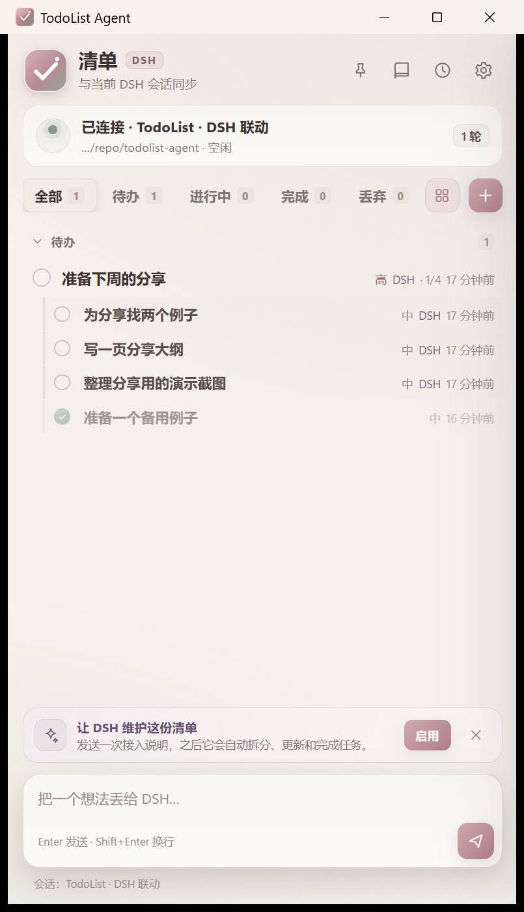
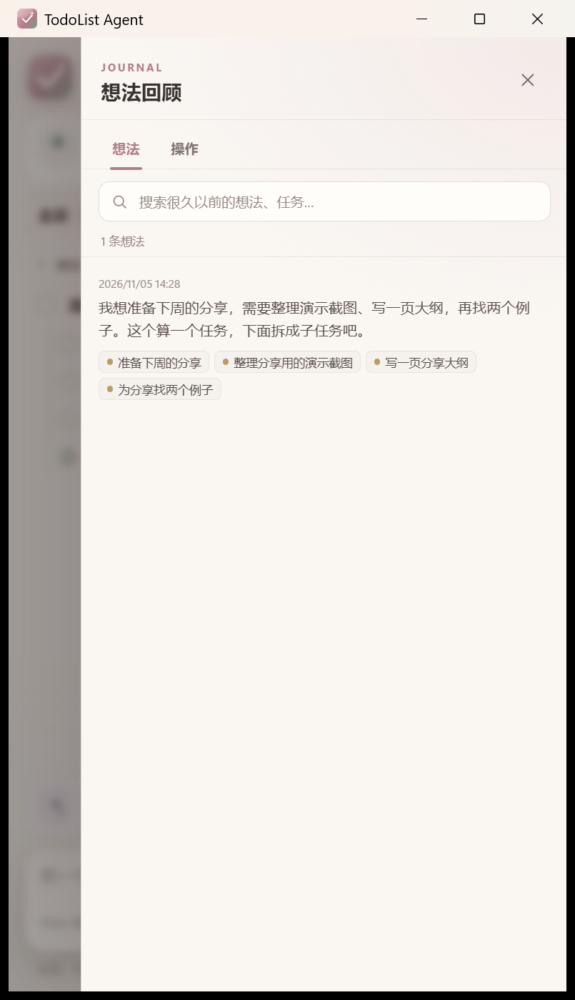
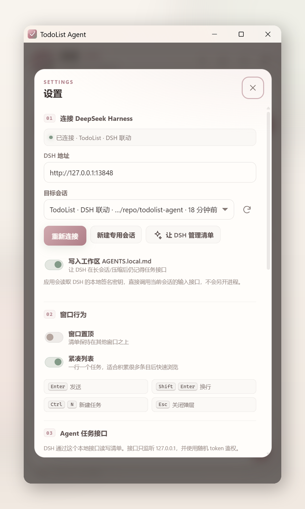
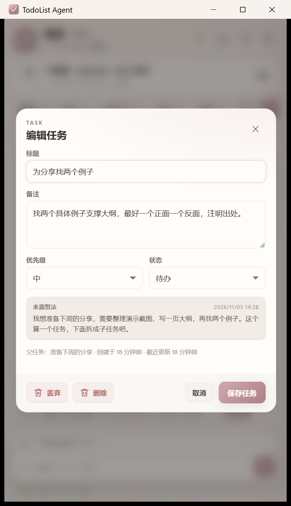

# TodoList Agent

**一个本地优先的 Windows 桌面清单，把杂乱想法交给 DeepSeek Harness，变成真正能执行的待办。**

[English](README.md) · [简体中文](README.zh-CN.md) · [观看演示](https://www.bilibili.com/video/BV1PR486wEGL/)

TodoList Agent 是一个用 **Go + WebView2** 编写的桌面应用。它连接一个专用的 **DeepSeek Harness（DSH）** 会话，让你可以直接在窗口底部写下此刻的想法，由 DSH 理解、拆解，并通过本地接口同步成任务。

它的重点不是“再做一个待办 App”，而是把“想法刚出现、还没想清楚”的那一步放进桌面：零散的句子、感慨、链接、半成形的计划，都可以先写下来。DSH 只把**明确的行动意图**提炼成任务；原始文字会进入可搜索的想法回顾，并和它产生的任务保持关联。

<p align="center">
  
</p>

## 演示视频

<p align="center">
  <a href="https://www.bilibili.com/video/BV1PR486wEGL/">
    
  </a>
</p>

B站 60 秒功能演示：从空清单开始，连续三轮对话，看 DSH 如何拆任务、处理子任务与专注，以及想法回顾和操作记录。

## 为什么做这个

大多数待办工具都假设你已经知道任务是什么了。但真实情况往往更早一点：你只有一个模糊的念头，一句埋在话里的截止时间，或者一段混杂了五件事的碎碎念。

TodoList Agent 把这一步搬到了桌面上：

- 想法出现时，就在原地写下来；
- DSH 在真实会话里读它，提炼出行动；
- 结果以干净的任务形式回来，原话仍然附着在旁边；
- 你可以继续修改、拆子任务、设专注、删除或完成，不用离开这个窗口。

桌面端通过本机的 TodoList 连接插件，把消息交给正在运行的 DSH。配对后的 Android 设备通过桌面端代发。

## 功能

### 真正的 DSH 会话，而不是单向表单

- 自动连接本机 DSH 的 TodoList 插件。
- 首次启动时创建并选中专用会话 `TodoList · DSH 联动`，之后持续复用。
- 你发出的内容会作为普通用户消息进入 DSH，Agent 能看到完整上下文并正常回复。
- DSH 可以通过本地桥接接口新增、修改、开始、完成、重新打开和删除任务。

### 允许杂乱输入，只提炼明确行动

- 一条消息里有多个行动点，可以拆成多个任务。
- 纯情绪、吐槽、转述和链接分享，不必强行变成任务。
- 想法中有明确时间（今晚、周五前、周末、下周等）时，时间会写进**任务标题**，而不是只藏在备注里。
- 修改任务时保留原始措辞和来源，不把历史抹掉。

### 一层子任务

当一个任务确实有步骤时，可以拆出子任务。例如“准备分享”可以拆成“写大纲 / 找例子 / 整理截图”。

- 父任务显示 `2/3` 这样的完成进度。
- 子任务可以独立完成或删除，完成子任务不会自动完成父任务。
- 子任务不能再嵌套，整个清单最多一层。
- 删除父任务会连同子任务一起删除，执行前会提示数量。

### 专注、优先级与排序

- 清单同时最多专注一项，主任务和子任务都可以设为专注。
- 专注项以玫瑰色边框和鼠尾草绿加粗标题高亮显示。
- 待办按**置顶 · 长期 / 高 / 中 / 低**四个优先级分段。
- DSH 从日常表达提炼的新待办默认追加到对应组末尾。用户明确要求前插时，DSH 可以通过 `placement: "first"` 指定位置。
- 把任务拖到另一段会改变优先级；在同一段内拖动只调整顺序。
- 每个任务在打钩圆圈右侧有很小的显示序号（如 `2.4`），DSH 可以用序号精确指代任务。

### 想法回顾与操作记录

从桌面输入框发出的每条内容都会保存为一条**想法**，即使它没有变成任务。

- 按时间倒序查看原文。
- 搜索旧想法或任务标题。
- 查看一条想法关联了哪些任务。
- 从任务详情跳回来源想法。
- 切换到**操作记录**，查看新增、完成、删除、移动等事件及其原话。

### 为长期清单准备

- 卡片视图：保留上下文和子任务展开。
- 紧凑视图：按状态和优先级快速扫几十上百条任务。
- 已完成分组默认折叠。
- 浅色暖纸主题，适合长时间停留在桌面上。
- 支持托盘运行，关闭窗口不退出。

<p>
  
  
</p>
<p>
  
  
</p>

## 环境要求

- **Windows 10/11（64 位）**
- **Microsoft Edge WebView2 Runtime**（Windows 11 通常自带）
- 本机已安装并运行 **DeepSeek Harness**

连接插件已在 **DSH 0.2.2-rc.1** 验证。其他版本会尝试加载，插件页会显示宿主版本和会话服务状态。Android 端支持 Android 8.0 及以上的 arm64 和 x86-64 设备。

## 安装

### 使用发布包

从 [GitHub Releases](https://github.com/Dusk-Hermit/todolist-agent/releases) 下载并运行 `TodoListAgent-Setup-win64.exe`。安装器会按当前用户安装、创建开始菜单快捷方式，并在系统缺少 WebView2 时联网补装。也可以解压 `TodoListAgent-win64.zip` 后运行 `install.cmd`。

### 安装 DSH 连接插件

在每台负责处理消息的 Windows 电脑上，从同一 Release 下载 `todolist-agent-dsh-connector-<版本>.tgz`，用 DSH 自带的命令安装到正在使用的配置。以桌面版为例，在 PowerShell 运行以下命令。

```powershell
dsh plugin --profile desktop add "C:\实际下载目录\todolist-agent-dsh-connector-0.4.15.tgz"
```

使用 DSH Web 版时将 `desktop` 改为 `web`，自定义配置则填入自己的配置名。如果 `dsh` 不在 PATH，可以用 PowerShell 的 `&` 调用 DSH 安装目录下的 `resources\runtime\cli\bin\dsh.cmd`。安装后重启该 DSH 配置，再打开 TodoList Agent，或在设置里点「重新连接」。Android 通过配对电脑获取执行结果。

### 免安装

`TodoListAgent.exe` 是单文件程序，放到任意目录直接运行即可，不需要安装器。

## 首次运行

1. 启动 **DeepSeek Harness**。
2. 启动 **TodoList Agent**。
3. 应用会自动连接 DSH 插件，并选中或创建专用会话 `TodoList · DSH 联动`。
4. 点击一次 **「让 DSH 维护这份清单」**，发送接入说明。它会告诉 DSH 本地接口地址、Token 和任务处理规则。
5. 可以选择写入 `AGENTS.local.md`，让长时间运行的 DSH 会话在上下文压缩后仍然记得这些规则。

之后：

- 在底部输入想法，按 `Enter` 发送。
- DSH 读取消息，通过本地接口更新清单。
- 用任务操作区编辑、拆子任务、删除、完成或设专注。

## Android 与局域网同步

1. Windows 和 Android 都安装 0.3.0 或以上版本。Android 安装同一 [GitHub Release](https://github.com/Dusk-Hermit/todolist-agent/releases) 中的 `TodoListAgent-android.apk`。
2. 将设备连到同一局域网。在电脑的 **设置 → 局域网同步** 生成配对码，复制到各 Android 设备并保存。
3. 应用会自动发现和同步已配对设备。点击顶部的刷新按钮可以立即搜索并查看结果。组播被路由器隔离时，可在手机设置中填入电脑的局域网 IPv4 地址。Windows 防火墙提示时允许应用访问专用网络，发现和同步使用 UDP 和 TCP 17891。
4. 每台 Windows 电脑分别连接并初始化自己的 DSH 会话，可在桌面设置修改地址和端口。手机可设置首选电脑。如果它离线或 DSH 不可用，手机会先与另一台可用电脑同步，再把新消息交给它。首选电脑恢复后会收到同步过的任务、消息和回复记录。Android 打开应用时参与同步。

设备间传输采用配对加密。每次同步只传输有变化的记录。不同任务上的修改会合并。同一任务发生并发冲突时，以该任务最新的编辑或删除为准。删除会保留同步标记，避免旧设备恢复已删除的任务。参与同步的设备都需要升级到 0.4.8 或更新版本。发现机制参考了 [LocalSend](https://github.com/localsend/localsend) 的 IPv4 组播通告和应答。

已同步的在线设备发送新消息时，空闲电脑只留约 350 毫秒收集同批输入。离线消息和刚恢复连接的设备仍有约五秒积压收集窗口。电脑将已收到的消息按各设备创建时间排序，与本机输入一起逐条交给 DSH。后到的消息会加入尚未发出的队列。批次完成后，电脑通知配对设备立即同步，定期同步也会继续运行。

在 Android 的系统分享菜单或长按文字的选单中选择 **TodoList Agent**，确认「加入待发队列」即可。分享的文字和在应用内输入的消息走同一条队列。

缺少 DSH 接收确认或执行结果时，桌面端会按原会话和请求 ID 核对，旧消息也可以按原有消息标记找回。可以点「重新核对」立即发起检查，或在 Android 点「刷新同步」拉取最新状态。「操作记录」会显示对应轮次及工具调用的成功、失败和未确认次数。无法确定结果的消息继续保留待核对，避免重复执行可能已生效的操作。请在保留原会话记录的 DSH 配置上核对。

多电脑代发请将手机和执行 DSH 的电脑都升级到 0.4.0 或更高版本。等待原电脑确认的消息保留原归属，避免超时后在两台电脑重复执行。各电脑的 DSH 会话上下文保存在原电脑。组播受限时可用逗号分隔多个手动地址。

### 安全使用局域网同步

- **在可信的家庭或办公网络使用。** 公共或访客 Wi‑Fi 上建议在「设置 → 局域网同步 → 停用」关闭同步。保持 Windows 防火墙开启，仅在可信网络上允许应用访问专用网络。避免在路由器上把 UDP 和 TCP 17891 端口转发到公网。 [Windows 防火墙网络配置文件](https://learn.microsoft.com/en-us/windows/security/operating-system-security/network-security/windows-firewall/#firewall-profiles)
- **把配对码当作密码保管。** 拿到配对码且能通过网络访问设备的人，可以冒充已配对的设备，读取或修改同步数据，也可以向已配对电脑上的 DSH 提交消息。配对码泄露或配对设备遗失时，生成新配对码，只给仍然信任的设备重新配对。
- **被截获的发现通告可以被重放。** 重放可能让应用尝试连接错误地址，干扰发现。同步和代发会另建加密连接并用配对码验证身份。仅重放通告无法读取任务或注入消息。

## 更新

Windows 和 Android 启动时自动检查 GitHub Release，也可以在「设置 → 关于」手动检查。发现新版本后，点击「一键更新」即可下载并校验相应安装包。Windows 完成安装后会重新启动应用。Android 可以在同一处开启自动下载并安装，系统可能要求允许安装来源或确认。0.3.0 及更早版本首次升级需要手动安装新版。

从 0.4.9 起，应用先通过 GitHub 最新正式版的下载直链读取发布清单，直链不可用时再查询 REST API。检查失败时，可在「设置 → 关于 → 打开 GitHub 发布页」的 Assets 里下载 `TodoListAgent-android.apk` 或 `TodoListAgent-Setup-win64.exe` 手动更新。 [最新正式版](https://github.com/Dusk-Hermit/todolist-agent/releases/latest)

发布正式版时，在安装包构建和签名完成后运行 `.\release-manifest.ps1 -Tag <版本标签> -Directory <发布文件目录>`，将生成的 `TodoListAgent-update.json` 和安装包一起上传。

请从本项目的 GitHub Releases 下载安装包。Windows 更新器通过 HTTPS 获取 GitHub 提供的 SHA‑256 摘要并校验安装包，因此依赖仓库发布权限的安全性。目前没有独立的发布者签名校验。

## 日常使用

| 操作 | 效果 |
|---|---|
| `Enter` | 发送给 DSH |
| `Shift+Enter` | 换行 |
| `Ctrl+N` | 新建本地任务 |
| `Ctrl+,` | 打开设置 |
| 点击左侧圆圈 | 完成 / 重新打开 |
| 点击任务标题 | 打开任务编辑 |
| 点击靶心按钮 | 设为专注 / 取消专注 |
| 拖住任务序号旁的把手 | 调整任务或子任务的顺序，也可把主任务移到其他优先级组。拖到列表上下沿会自动滚动。 |
| 书本图标 | 打开想法回顾 |
| 时钟图标 | 打开操作记录 |
| 列表 / 网格图标 | 切换卡片 / 紧凑视图 |

## 工作原理

### DSH 连接与执行回执

插件默认绑定 `127.0.0.1:17892`。需要换端口时，在当前 DSH 配置的 `cordis.patch.yml` 中将插件行 `todolist-agent-connector` 的 `config.port` 改成指定端口。插件将实际端口和每次启动生成的连接密钥写入 `%USERPROFILE%\.dsh\todolist-connector.json`。桌面端只访问这个端口，请求和回执均加密并校验身份。请将这个文件保留在自己的 Windows 账户中。

插件的 `/todolist/v1/rpc` 接口负责列出、创建和重命名会话、提交文本消息及查询回执。`todolist/status` 根据原会话记录返回消息进入时间、轮次、结束原因和工具结果摘要。`todolist/wait` 订阅轮次结束事件，桌面端同时保留定期查询以便重连恢复。

在 DSH 的「插件 → todolist-agent-dsh-connector」可选择模型后端、模型和推理强度。保存后，TodoList 下次发送时会把这些设置应用到所选会话。选择「跟随会话设置」则沿用该会话当前的模型。TodoList Windows 端只连接插件端口，Android 只连接配对电脑的局域网服务。

同一页显示实际监听地址、版本、事件等待上限和近期运行日志。「检查更新」先读 GitHub Release 直链清单，「在线更新」找到新正式版后校验安装包的大小及 SHA-256，再安装到当前 DSH 配置。重启 DSH 后使用新版本。

### 专用会话

如果没有已保存的专用会话，应用调用 `session/create` 创建新会话，重命名为 `TodoList · DSH 联动` 并选中。会话工作目录优先跟随当前正在运行的 DSH 会话；没有运行中的会话时，使用最近活跃会话的目录。

应用不会劫持你正在使用的会话。设置页提供 **「新建专用会话」**。

### 发送一条想法

输入框通过 `session/prompt` 发送普通消息。消息末尾会附带一个隐藏标记：

```html
<!-- todo-msg:<id> -->
```

DSH 将它作为 `sourceMessageId` 传回，应用据此把任务、操作事件和原始想法关联起来。即使 DSH 没有传，应用也会在六小时内把新任务回退关联到最近一条用户消息。

### 反向桥接

应用在 `127.0.0.1:17890`（可配置）监听，使用随机 Bearer Token。地址和 Token 写入 `%APPDATA%\TodoListAgent\bridge.json`。

DSH 可以调用：

```http
GET  /api/todos
GET  /api/journal?limit=20&q=关键词

POST /api/todos
```

动作示例：

```json
{"action":"add","title":"周五前准备下周的分享","priority":"high","sourceMessageId":"..."}
{"action":"update","id":"...","title":"...","status":"doing"}
{"action":"complete","id":"..."}
{"action":"delete","id":"..."}
```

`GET /api/todos` 的每个任务都带有只用于显示的 `number` 字段（如 `2.4`）。用户用序号指代任务时，DSH 应按这个字段精确匹配。

## 任务模型

### 状态

`todo` → `doing` → `done`

删除任务会将它移出清单，并写入操作记录。升级后，旧版已丢弃的任务会移出清单，原始记录保留在操作记录中，其余子任务会升为主任务。

### 备注结构

任务备注固定为两段：

```text
{{当前详细描述}}

-------

- {{最新原话}}
- {{较早原话}}
```

详细描述会随着任务变化而重写；原话只追加、不改写，最新的放最上面。这样任务详情上半部分始终是最新、可执行的信息，下半部分才保留历史语气和上下文。

### 显示序号

序号根据当前排序实时计算，不写入数据：

- 顶层任务：`1`、`2`、`3`……
- 子任务：`2.4`，表示第 2 个顶层任务下的第 4 个子任务。

序号会随拖动、优先级和状态变化，所以 DSH 操作前应重新读取 `GET /api/todos`。

## 数据与隐私

| 路径 | 内容 |
|---|---|
| `%APPDATA%\TodoListAgent\data.json` | 任务、想法、操作事件、偏好、桥接 Token |
| `%APPDATA%\TodoListAgent\bridge.json` | 本地桥接地址与 Bearer Token |
| `%APPDATA%\TodoListAgent\icon.ico` | 运行时窗口图标 |

- 任务、想法和操作记录保存在本机。启用局域网同步后，这些数据会同步到配对设备。
- 桥接服务只监听回环地址。
- 连接密钥由本机插件生成，仅在 Windows 桌面端和本机插件之间使用。
- 应用不截屏、不控制键盘、不自动化 DSH 界面。

## 从源码构建

需要：

- Go 1.26.10+
- `rsrc`（用于嵌入 Windows 图标）
- Windows SDK / WebView2 开发环境

```powershell
git clone https://github.com/Dusk-Hermit/todolist-agent.git
cd todolist-agent
.\build.ps1
```

构建脚本会嵌入 Web UI、图标和 manifest，并输出 `dist\TodoListAgent.exe` 与 `dist\TodoListAgent-win64.zip`。

```powershell
# 另需 Inno Setup 6，生成 Windows 安装程序
.\build.ps1 -Installer
```

Android 开发时在 Android Studio 打开 `android/`。使用 JDK 17、Gradle 8.6、Android SDK 34 和 NDK 27.0.12077973。在 Windows 上也可以运行 `gradle -p android :app:assembleDebug`，APK 生成在 `android/app/build/outputs/apk/debug/`。

## 项目结构

```text
app.go        应用状态、任务操作、快照
store.go      持久化与迁移
dsh.go        DSH 发现、专用会话、消息发送
bridge.go     DSH 使用的本地回环接口
window_windows.go   WebView2 绑定与窗口生命周期
win32_windows.go    Windows 标题栏、图标和窗口行为
android/      Android Studio 项目
lan*.go       设备发现、配对传输和同步
replica.go    增量合并与冲突处理
web/          内嵌 HTML/CSS/JS 界面
install.ps1   当前用户安装器
build.ps1     发布构建
docs/         截图
```

## 设计取舍

- **本地优先。** 不需要账号、没有云同步，除了回环桥接没有常驻后台服务。
- **只做一层嵌套。** 足够表达真实步骤，又不会把清单变成无限深的树。
- **保留原话。** 摘要很有用，但几个月后，来源往往才是最值钱的上下文。
- **专用会话。** Agent 有稳定的工作空间，同时不占用你正在聊的会话。

## 限制

- 仅支持 Windows。
- 需要本机运行中的 DSH。
- 按设计最多一层子任务。
- 桥接接口只面向本机，不适合远程访问。
- DSH 仍在快速迭代，内部 API 变化可能需要应用跟进。

## 致谢

- 使用 [Go](https://go.dev/)、[go-webview2](https://github.com/jchv/go-webview2) 和 [systray](https://github.com/getlantern/systray) 构建。
- DSH 集成使用 DeepSeek Harness 的插件和会话服务。
- 视觉方向受暖纸、灰粉和鼠尾草绿启发。

---

如果 TodoList Agent 对你有用，欢迎点一个 Star。Bug 和聚焦的 Pull Request 都欢迎。
